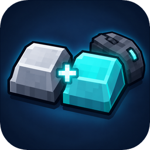

<p align="center">
  
</p>

<h1 align="center">MX Secondary Keys</h1>

<p align="center">
  A client-side Fabric mod for Minecraft 26.3 that gives every key binding a second, independent key.<br>
  Works for vanilla actions and for actions added by other mods.
</p>

---

The second key does not replace the primary one. Both keys trigger the action, and you can bind keyboard keys and mouse buttons to either slot.

## Features

- **A second key for every action**: bind e.g. *Jump* to `Space` **and** `Mouse 4`.
- **Combined editor**: one screen shows each action with columns for *Primary*, *Secondary* and *Reset*. You can change both bindings there.
- **Behaves like vanilla**:
  - Holding an action (walking, sneaking, attacking) works with either key.
  - Releasing one key keeps the action pressed while the other key is still held.
  - Toggle sneak and toggle sprint work as usual.
  - The secondary key also works inside screens, e.g. closing the inventory or using hotbar keys in containers.
- **Conflict warnings**: keys used by more than one action are marked yellow, like in the vanilla screen.
- **Safe to remove**: your primary bindings stay in `options.txt`, untouched, and the secondary bindings are stored in a separate file. If you uninstall the mod, all your normal key bindings stay exactly as they were.

## Usage

- **Options → Controls → Secondary Keybinds...** You can also assign a key that opens the editor in game under *Key Binds → Secondary Keys* (unassigned by default).
- Click the button in the *Primary* or *Secondary* column, then press a key or mouse button.
- Press **Esc** while assigning to remove a binding.
- **Reset** sets the primary key back to its default and clears the secondary key. **Reset Keys** does this for every action.

Secondary bindings are saved in `config/mxsecondarykeys.txt` as `<action>:<key>` lines, for example `key.jump:key.mouse.4`.

## Requirements

- Minecraft 26.3
- Fabric Loader ≥ 0.19
- [Fabric API](https://modrinth.com/mod/fabric-api)

Install the mod on the client only. Servers don't need it.

## Building

```sh
./gradlew build          # → build/libs/MXSecondaryKeys-26.3-dev.jar
./gradlew runClient      # start a test client
```

Requires JDK 25.

## Tests

```sh
./gradlew runClientGameTest
```

starts a game client and creates a world. It binds keyboard keys and a mouse button as secondary keys for jump, presses and releases them in every order, saves and loads the config file, checks that the open-editor key is unassigned by default and opens the editor with it once bound and from the controls screen. Screenshots end up in `build/run/clientGameTest/screenshots/`.

## Releases

Every push to `main` with relevant changes builds the mod and publishes a GitHub release named `v<mc>-patch-<n>`, e.g. `v26.3-patch-1`. The changelog is generated from [Conventional Commit](https://www.conventionalcommits.org/) messages: `feat:` goes under Features, `fix:` and `perf:` under Fixes. `docs:`, `ci:`, `test:` and `style:` commits are left out and do not trigger a release on their own.

## License

MIT
